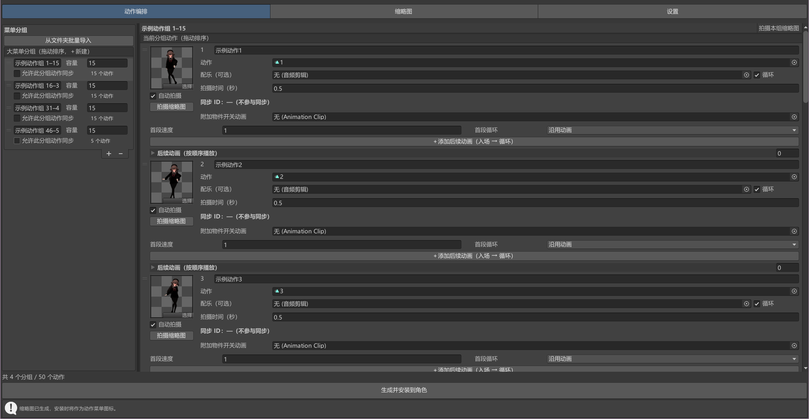
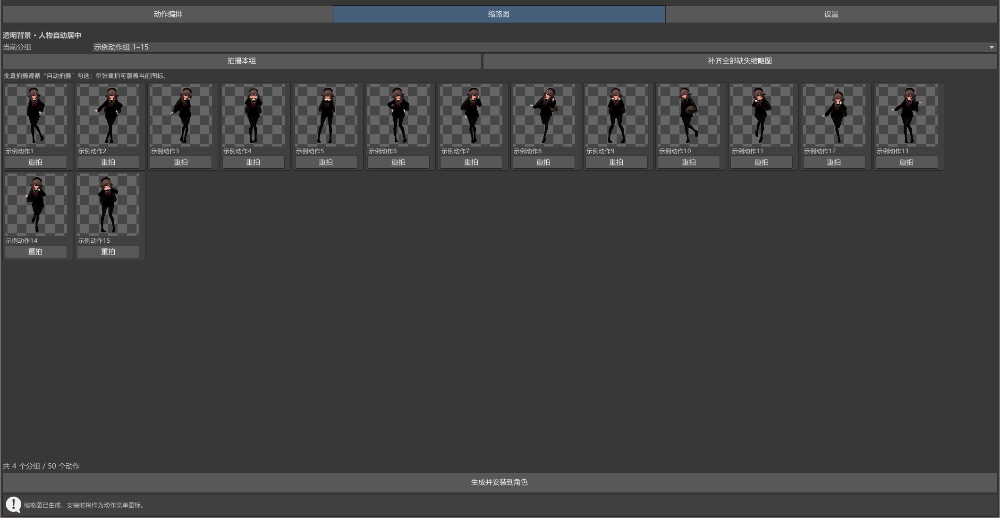
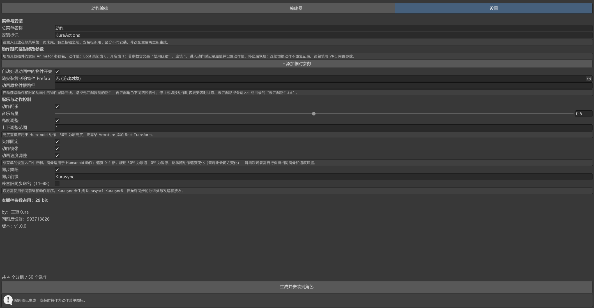

# Kura 动作管理器

VRChat Avatar 用的动作管理器：动作分组与多级菜单、批量导入、缩略图拍摄、循环动作、镜像与变速、同步舞蹈、物件开关，一键安装进 Avatar。

## 界面

**动作编排**：左侧管理大菜单分组与容量，右侧拖入动作、配乐、缩略图、后续动画。



**缩略图**：批量拍摄、单张重拍、补齐缺失；透明背景，按可见像素自动居中。



**设置**：高度调整、头部固定、动作镜像/变速、同步舞蹈、物件开关等统一在这里配置，底部显示参数占用 bit 数。



## 通过 VCC / ALCOM 安装

1. 打开 VCC（或 ALCOM）→ **Settings → Packages**
2. 在 **Repositories** 一栏点 **Add Repository**
3. 粘贴：

```
https://guiltycrownsa.github.io/KuraActionManager/index.json
```

4. 回到项目页，在 **Manage Project** 里勾选 **Kura 动作管理器** 并安装。
5. 之后有新版本时，VCC/ALCOM 会在这个列表里提示更新，点一下即可升级。

## 依赖

- VRChat Avatars SDK 3.7.0 以上（构建于 3.10.5）
- [Modular Avatar](https://vpm.nadena.dev/) 1.10.0 以上

如果 VCC 提示找不到 `nadena.dev.modular-avatar`，请先把 MA 的仓库加进来：

```
https://vpm.nadena.dev/vpm.json
```

## 使用

安装完成后，Unity 菜单栏 **王冠Kura → 动作管理器** 打开窗口。

生成的动画、缩略图、配置会放在 `Assets/KuraActionInstaller/` 下，升级包不会动这些数据。

## 仓库结构

```
Packages/com.kura.actionmanager/   包本体（Editor 脚本）
.github/workflows/release.yml      打版本：压 zip + 生成 unitypackage + 发布 Release
.github/workflows/build-listing.yml 生成 VPM 列表 index.json 并发布到 GitHub Pages
source.json                        列表源配置
```

## 开发与发布

包在 Unity 工程里开发（`Packages/com.kura.actionmanager`），改完同步到本仓库：

```powershell
pwsh -File Tools\sync.ps1 -UnityProject "你的Unity工程路径" -Commit "feat: 说明"
```

发布新版本：

1. 改 `Packages/com.kura.actionmanager/package.json` 里的 `version`
2. 同步并推送
3. GitHub → Actions → **Build Release** → Run workflow
4. Action 会压 zip、生成 unitypackage、发 Release，并自动触发 **Build Repo Listing** 更新 `index.json`
5. VCC/ALCOM 里刷新一下就能看到新版本

旧版本的 Release 不要删除，否则使用源码管理的项目会失效。
